<picture>
  <source media="(prefers-color-scheme: dark)" srcset="./assets/hero-dark.svg">
  
</picture>

 

I'm a Junior AI Engineer at **[Kenpath](https://kenpath.io)**, working across full-stack development and AI. Outside work I build two things I care about: a framework for training language models from first principles, and a messenger that doesn't need anyone's servers.

 

<a href="https://learn-rust-flame-site.vercel.app"><picture><source media="(prefers-color-scheme: dark)" srcset="./assets/flame-dark.svg"></picture></a>&nbsp;<a href="https://github.com/Tejascodex001/sanctum"><picture><source media="(prefers-color-scheme: dark)" srcset="./assets/sanctum-dark.svg"></picture></a>

**FLAME** is built at RTensorLabs: a hand-written Transformer, tokenizer and optimizer in Rust, with training you can pause and resume to bit-identical weights. [Learn how it works](https://learn-rust-flame-site.vercel.app) · [Try the visualizer](https://huggingface.co/spaces/Tejascodex001/flame-visualizer)

**Sanctum** sends messages, photos and calls straight between phones over Tor onion services. Each chat gets a sigil generated from its keys: if both phones show the same one, nobody is listening. [Source and download](https://github.com/Tejascodex001/sanctum)

 

### Other work

| | | |
|:--|:--|:--|
| [**GuardLayer**](https://github.com/Tejascodex001/GuardLayer) | Guardrails middleware that screens LLM inputs and outputs for prompt injection, jailbreaks, toxicity and PII, with an explainable risk score | Python |
| [**SmartGuard**](https://github.com/Tejascodex001/smartguard) | LLM firewall built on a DeBERTa classifier, 99.7% recall on prompt injection at ~40 ms on CPU | Python |
| [**Vision Engine**](https://github.com/Tejascodex001/Cpp-image-and-video-processing-pipeline) | Real-time video pipeline with hand-written convolutions and zero heap allocations in the hot loop | C++ |
| [**Anomaly Detector**](https://github.com/Tejascodex001/System-anomaly-detector) | Multithreaded Linux telemetry collector that flags anomalies with rolling z-scores | C++ |
| [**Auto-Immunity**](https://github.com/Tejascodex001/Auto-immunity-for-systems) | Cyber-defense simulation where RL agents and a RAG-backed LLM respond to attacks | Python |

 

### Experience

**Kenpath** · Junior AI Engineer · Sep 2026 – present 
Full-stack development and AI engineering.

**CGI** · Software Engineer Intern · 2025 
Built an OCR pipeline with PaddleOCR that fed extracted documents into a RAG system for question answering.

**Global Academy of Technology** · B.E. AI & Data Science · 2026 
Graduated with a CGPA of 9.5.

 

### Tools

**Languages** Rust, C++, Python, Dart 
**ML** PyTorch, Candle, CUDA, TensorFlow, scikit-learn, OpenCV 
**Everything else** Flutter, Docker, Linux (Arch), Git

 

[tejas12gowda@gmail.com](mailto:tejas12gowda@gmail.com) · [LinkedIn](https://linkedin.com/in/tejas-gowda-sridhara) · [X](https://twitter.com/tejas_gowda_001)
