<p align="center">
  
</p>

<p align="center">
  
</p>

<p align="center">
  <a href="https://git.io/typing-svg"></a>
</p>

<p align="center">
  <a href="https://kenpath.io"></a>
  <a href="mailto:tejas12gowda@gmail.com"></a>
  <a href="https://linkedin.com/in/tejas-gowda-sridhara"></a>
  <a href="https://twitter.com/tejas_gowda_001"></a>
</p>

---

## ⚡ `cat about.md`

```rust
struct Tejas {
    role:      "Junior AI Engineer @ Kenpath — full stack + AI",
    building:  ["FLAME — LLMs from scratch in Rust", "Sanctum — private P2P messenger"],
    education: "B.E. AI & Data Science, Global Academy of Technology — 2026, 9.5 CGPA 🎓",
    obsessed:  ["LLM internals", "low-level systems", "privacy & security"],
    stack:     ["Rust", "C++", "Python", "Flutter"],
    based_in:  "Bangalore, India 🇮🇳",
    off_hours: ["🎮 games", "🎵 music", "🎬 anime"],
}
```

---

## 🔥 Flagship Work

<table>
<tr>
<td width="50%" valign="top">

### 🔥 FLAME &nbsp;<sub>`RTensorLabs`</sub>
**Framework for Lightweight AI Model Engineering.**

A small, readable **Rust + Candle** framework for training language models **from scratch on one laptop**. Covers the whole pipeline: a BPE tokenizer, a Transformer (RoPE, SwiGLU, RMSNorm), hand-written AdamW and a training run you can pause and resume to the exact same weights. Its logits match a PyTorch reference to within **5e-7**.

- 🧪 **FLAME-Research**: dynamically routed modular models compared against dense and MoE baselines
- 🦀 **Lintless**: the FLAME Rust base model fine-tuned to explain and fix `rustc` errors. A fix only counts if the file compiles afterwards

<a href="https://huggingface.co/spaces/Tejascodex001/flame-visualizer"></a> <a href="https://learn-rust-flame-site.vercel.app"></a><br/>
   

</td>
<td width="50%" valign="top">

### 🔒 [Sanctum](https://github.com/Tejascodex001/sanctum) &nbsp;<sub>`beta`</sub>
**Private chat for close friends. No servers, no accounts, no tracking.**

Peer-to-peer Android messenger over **Tor onion services** with **MLS end-to-end encryption**, groups of 50, voice/video calls, offline Wi-Fi/Bluetooth mesh, decoy PIN & panic wipe — and a unique **sigil** per chat to verify nobody's listening.

   

</td>
</tr>
</table>

## 🛠 More Projects

| Project | What it is | Stack |
|---|---|---|
| 🦀 **Lintless** <sub>(RTensorLabs)</sub> | Fine-tuned FLAME model that explains & fixes Rust compiler errors, data mined by mutating real code | Rust · Candle |
| 🛡 **[GuardLayer](https://github.com/Tejascodex001/GuardLayer)** | Defense-in-depth guardrails middleware for LLMs — prompt-injection, jailbreak, toxicity & PII guards with explainable risk scores | Python · MiniLM · NLP |
| 🧱 **[SmartGuard](https://github.com/Tejascodex001/smartguard)** | LLM input/output firewall — DeBERTa classifier (99.7% recall), red-team suite, ~40ms CPU P95 | Python · DeBERTa · ONNX |
| 🎥 **[C++ Vision Engine](https://github.com/Tejascodex001/Cpp-image-and-video-processing-pipeline)** | Zero-allocation real-time image/video pipeline with hand-written convolutions & live telemetry HUD | C++17 · OpenCV · CMake |
| 📈 **[System Anomaly Detector](https://github.com/Tejascodex001/System-anomaly-detector)** | Multithreaded `/proc` telemetry collector with rolling z-score anomaly scoring | Modern C++ · Concurrency |
| 🧬 **[Auto-Immunity for Systems](https://github.com/Tejascodex001/Auto-immunity-for-systems)** | Self-learning cyber-defense: RAG-powered LLM + RL agents in a Dockerized battleground | Python · RL · RAG · Docker |
| 🚚 **[Zip Route](https://github.com/Tejascodex001/delivery-route-app)** | Multi-stop delivery route optimization | Python |

<details>
<summary><b>🗄 Archive</b></summary>

- **[FaceNet](https://github.com/Tejascodex001/FaceNet)** — one-shot face verification with embeddings
- **[Sign Language Translator](https://github.com/Tejascodex001/sign-language)** — real-time ASL → text (79.3% acc.)
- **[Face Recognition Attendance](https://github.com/Tejascodex001/face_recognize_attendance_system)** — automated attendance with OpenCV
</details>

---

## 💼 Experience

```diff
+ Junior AI Engineer · Kenpath                                Sep 2026 — present
!   Full-stack development & AI engineering — kenpath.io

- Trainee Software Engineer Intern · CGI                                    2025
    OCR pipeline with PaddleOCR → structured extraction → RAG document Q&A
```

---

## 🧰 Toolbox

<p align="center">
  <br/><br/>
  
</p>

---

## 📊 Stats

<p align="center">
  
  
</p>
<p align="center">
  
</p>

---

<p align="center">
  <b>Open to collabs on LLMs, systems programming, privacy tech & security.</b><br/>
  <sub>🏅 Cisco Intro to Cybersecurity · NPTEL Python & Data Science for Engineers · Infosys Python / Front-End / Networking</sub>
</p>

<p align="center">
  
</p>

<p align="center">
  
</p>
