<picture>
  <source media="(prefers-color-scheme: dark)" srcset="./assets/hero-dark.svg">
  
</picture>

I'm **Tejas Gowda S**, a Junior AI Engineer at **[Kenpath](https://kenpath.io)**,
working across full-stack development and AI.

I also maintain **[RTensorLabs](https://github.com/RTensorLabs)**, an independent
research and engineering lab. My current projects explore language models,
systems engineering, and private communication. The lab is a home for new ideas
across fields, with the problem guiding what we build next.

## Projects at RTensorLabs

### FLAME · Language models from first principles

<a href="https://learn-rust-flame-site.vercel.app/"><picture><source media="(prefers-color-scheme: dark)" srcset="./assets/flame-dark.svg"></picture></a>

A framework for building and training language models in **Rust with Candle**,
with a hand-written Transformer, tokenizer, and optimizer. The learning site and
interactive visualizer explain the pieces behind the model.

[Explore FLAME](https://learn-rust-flame-site.vercel.app/) ·
[Try the visualizer](https://huggingface.co/spaces/Tejascodex001/flame-visualizer)

### Sanctum · A private space for your close circle

<a href="https://sanctum-rtensorlabs.vercel.app/"><picture><source media="(prefers-color-scheme: dark)" srcset="./assets/sanctum-dark.svg"></picture></a>

An Android messenger built with **Rust and Flutter**. Chats, calls, photos, and
plans travel between phones, with end-to-end encryption and Tor by default.
Personal sigils make conversations recognisable; QR verification and safety
numbers help friends check identities. A matching sigil does not guarantee that
a phone or network is uncompromised.

[Website](https://sanctum-rtensorlabs.vercel.app/) ·
[Source](https://github.com/RTensorLabs/sanctum) ·
[Download the Android beta](https://github.com/RTensorLabs/sanctum/releases/latest)

## Other work

| Project | What I explored |
|:--|:--|
| [**GuardLayer**](https://github.com/Tejascodex001/GuardLayer) | Python middleware for screening LLM inputs and outputs, with checks for prompt injection, jailbreaks, toxicity, and personal information. |
| [**SmartGuard**](https://github.com/Tejascodex001/smartguard) | An LLM firewall using a DeBERTa classifier to detect prompt injection. |
| [**Vision Engine**](https://github.com/Tejascodex001/Cpp-image-and-video-processing-pipeline) | A real-time C++ image and video pipeline with hand-written convolutions. |
| [**Anomaly Detector**](https://github.com/Tejascodex001/System-anomaly-detector) | A multithreaded Linux telemetry collector using rolling z-scores to flag anomalies. |
| [**Auto-Immunity**](https://github.com/Tejascodex001/Auto-immunity-for-systems) | A cyber-defense simulation combining reinforcement learning and a RAG-backed language model. |

## Background

**Kenpath · Junior AI Engineer** 
September 2026 – present · Full-stack development and AI engineering.

**CGI · Software Engineer Intern** 
2025 · Built an OCR pipeline with PaddleOCR, feeding extracted documents into a
RAG system for question answering.

**Global Academy of Technology · B.E. in AI & Data Science** 
2026 · Graduated with a CGPA of 9.5.

## Tools I work with

**Languages:** Rust, C++, Python, Dart 
**ML:** PyTorch, Candle, CUDA, TensorFlow, scikit-learn, OpenCV 
**Development:** Flutter, Docker, Linux (Arch), Git

## Connect

[Email](mailto:tejas12gowda@gmail.com) ·
[LinkedIn](https://linkedin.com/in/tejas-gowda-sridhara) ·
[X](https://twitter.com/tejas_gowda_001) ·
[RTensorLabs](https://github.com/RTensorLabs)
